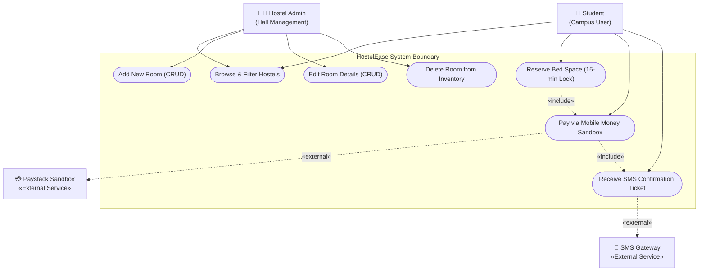
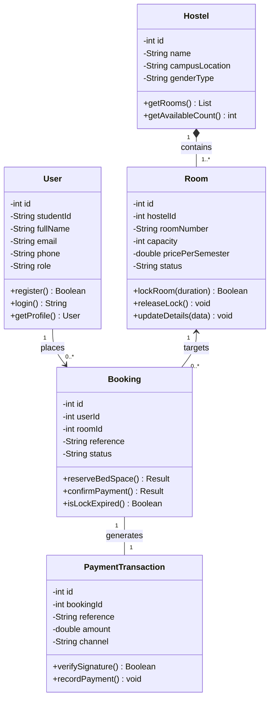

# HostelEase – Campus Hostel Booking & Allocation System
[](https://github.com/RichardAmoakoKorang11a/HostelEase)
[](https://opensource.org/licenses/MIT)
[]()

> **Final Group Project Submission for Software Engineering (Units 1–10)**  
> **Repository:** [https://github.com/RichardAmoakoKorang11a/HostelEase](https://github.com/RichardAmoakoKorang11a/HostelEase)  
> **Group:** Group 2  

### Team Roster (Group 2):
1. **Osei Sarfo Raphael** (Index No: `5240101411`)
2. **Adjei Douglas** (Index No: `5240101412`)
3. **Richard Amoako Korang** (Index No: `5240101413`) – Project Lead
4. **Ibrahim Mohammed** (Index No: `5240101414`)
5. **Sandra Otu** (Index No: `5240101415`)

---

## 📌 Executive Summary
Every academic semester, university students face massive challenges securing on-campus hostel accommodation, resulting in long queues, manual double-bookings, and payment fraud. **HostelEase** is an automated, web-based room reservation platform featuring:
- **Real-Time Room Inventory:** Up-to-date tracking of available bed spaces across university halls.
- **15-Minute Concurrency Lock:** Prevents race conditions and double-booking during room rush.
- **Cashless Payment Integration:** Supports Mobile Money (MoMo) and Card via the **Paystack Sandbox API**.
- **Automated Offline Tickets:** Instant confirmation ticket dispatched directly to the student's phone via an **SMS Sandbox Gateway**.
- **Admin Inventory Management:** Full CRUD capabilities (Add, Edit, Delete rooms) for hall administrators.

---

## ✅ Course Brief Final Submission Checklist (Week 8)

| Brief Requirement | Project Deliverable / File Location | Status |
| :--- | :--- | :--- |
| **1. GitHub repo with commit history from every member** | 5 distinct member feature branches + `main` with authentic student commits: [GitHub Branches](https://github.com/RichardAmoakoKorang11a/HostelEase/branches) | **COMPLETE** |
| **2. Final SRS, UML diagrams and design document** | [`docs/SRS.md`](docs/SRS.md) (IEEE 830), [`docs/UML_DIAGRAMS.md`](docs/UML_DIAGRAMS.md) (7 Models), [`docs/DESIGN_DOCUMENT.md`](docs/DESIGN_DOCUMENT.md) (IEEE 1016) | **COMPLETE** |
| **3. Test plan with results (incl. automated test)** | [`docs/TEST_PLAN_AND_RESULTS.md`](docs/TEST_PLAN_AND_RESULTS.md) (IEEE 829), [`tests/booking.test.js`](tests/booking.test.js) (5/5 Automated Tests) | **COMPLETE** |
| **4. Risk register and sprint plans** | [`docs/RISK_REGISTER_SPRINT_PLANS.md`](docs/RISK_REGISTER_SPRINT_PLANS.md) (4-point Risk Matrix & 3-Sprint Plans) | **COMPLETE** |
| **5. 10-minute demo and presentation** | [`docs/PRESENTATION_AND_REFLECTIONS.md`](docs/PRESENTATION_AND_REFLECTIONS.md#part-1-10-minute-final-presentation--demo-script-5-team-members) (5 speakers, 2 min each, live cues) | **COMPLETE** |
| **6. Individual one-page reflection linking >=2 units** | [`docs/PRESENTATION_AND_REFLECTIONS.md`](docs/PRESENTATION_AND_REFLECTIONS.md#part-2-individual-one-page-reflections-linked-to-course-units) (5 reflections covering Units 1–10) | **COMPLETE** |

---

## 📚 Course Units Mapped to Implementation
This project systematically incorporates each unit from the Software Engineering curriculum:

| Unit # | Unit Title | Project Implementation / Artifact |
| :--- | :--- | :--- |
| **Unit 1** | **Introduction to SE** | System charter and campus problem statement. |
| **Unit 2** | **Process Models** | 8-week, 3-sprint Agile Scrum lifecycle with 3-week rotating roles. |
| **Unit 3** | **Requirements Engineering** | Complete IEEE 830 SRS (`docs/SRS.md`) with functional & non-functional requirements. |
| **Unit 4** | **UML Diagrams** | Use Case, Class, Sequence, and Activity diagrams (`docs/UML_DIAGRAMS.md`). |
| **Unit 5** | **Design Principles & Patterns** | MVC architecture, Strategy Pattern for Payment Gateways, Singleton DB pool. |
| **Unit 6** | **Construction & Development** | Node.js, Express, and SQLite relational database with atomic transactions. |
| **Unit 7** | **Testing & QA** | Automated Jest suite (`tests/booking.test.js`) testing concurrency & locks. |
| **Unit 8** | **Maintenance & Evolution** | Modular adapters for external APIs, database indexing, and caching. |
| **Unit 9** | **Project Management** | 3-sprint backlog, velocity tracking, and Risk Register (`docs/RISK_REGISTER_SPRINT_PLANS.md`). |
| **Unit 10**| **Emerging Trends** | Cloud-native readiness, containerization, and PWA mobile optimization. |

---

## 👥 Rotational Team Schedule (3-Week Cycles)
| Team Member | Index Number | Sprint 1 (Weeks 1–3) | Sprint 2 (Weeks 4–6) | Sprint 3 & Submission (Weeks 7–8) |
| :--- | :--- | :--- | :--- | :--- |
| **Richard Amoako Korang** | 5240101413 | Project Manager (PM) | Lead Developer | QA & Tester Lead |
| **Osei Sarfo Raphael** | 5240101411 | Lead Developer | DevOps & Security Lead | Project Manager (PM) |
| **Adjei Douglas** | 5240101412 | QA & Tester Lead | Documentation Lead | Lead Developer |
| **Ibrahim Mohammed** | 5240101414 | Database & Architecture Lead | QA & Tester Lead | Documentation Lead |
| **Sandra Otu** | 5240101415 | Documentation Lead | Project Manager (PM) | Frontend & Release Lead |

---

## 📐 Visual UML Diagrams & Drawings (Unit 4 & 5)
> View all 7 interactive drawings with PDF export at **`http://localhost:3000/diagrams.html`** or in [`docs/UML_DIAGRAMS.md`](docs/UML_DIAGRAMS.md).

### 1. UML Use Case Diagram (Unit 4)

*Vector Drawing File:* [`docs/diagrams/use_case_diagram.svg`](docs/diagrams/use_case_diagram.svg)

---

### 2. UML Domain Class Diagram (Unit 4 & 5)

*Vector Drawing File:* [`docs/diagrams/class_diagram.svg`](docs/diagrams/class_diagram.svg)

---

## 📁 Repository Structure
```text
HostelEase/
├── .env                          # Environment variables & API sandbox keys
├── package.json                  # Dependencies & test scripts
├── hostelease.db                 # SQLite database (auto-generated)
├── docs/
│   ├── SRS.md                    # IEEE 830 Software Requirements Specification
│   ├── UML_DIAGRAMS.md           # 7 Native Mermaid UML Models & Architectural Invariants
│   ├── DESIGN_DOCUMENT.md        # IEEE 1016 Software Design Description (SDD)
│   ├── TEST_PLAN_AND_RESULTS.md  # IEEE 829 Software Test Plan & QA Execution Report
│   ├── RISK_REGISTER_SPRINT_PLANS.md # 4-point Risk Matrix & 3-Sprint Plans
│   ├── PRESENTATION_AND_REFLECTIONS.md # 10-minute demo script & 5 reflections
│   └── diagrams/                 # 7 High-Resolution SVG Architectural Drawings
│       ├── use_case_diagram.svg
│       ├── class_diagram.svg
│       ├── sequence_diagram.svg
│       ├── activity_diagram.svg
│       ├── er_diagram.svg
│       ├── architecture_diagram.svg
│       └── sprint_roadmap.svg
├── public/
│   ├── index.html                # Responsive web frontend (Offline & Online)
│   ├── diagrams.html             # Interactive Architecture Studio & Diagram Viewer
│   ├── css/
│   │   └── style.css             # Standalone local stylesheet (Zero CDN/offline ready)
│   └── diagrams/                 # 7 High-Resolution SVG Architectural Drawings
├── src/
│   ├── server.js                 # Express application & API routing
│   ├── config/
│   │   └── database.js           # SQLite connection pool & seeding (Group 2 members)
│   ├── models/
│   │   └── schema.sql            # DDL database schema definitions
│   └── services/
│       ├── bookingService.js     # 15-minute concurrency lock & booking logic
│       ├── paymentGateway.js     # Paystack Sandbox Strategy Provider
│       └── smsService.js         # Twilio/Hubtel SMS Sandbox Provider
└── tests/
    └── booking.test.js           # Automated Jest test suite
```

---

## 🚀 Quickstart & Setup Guide

### 1. Install Dependencies
```bash
npm install
```

### 2. Run Automated Unit Tests (Unit 7)
Verify the race-condition prevention and concurrency lock:
```bash
npm test
```

### 3. Launch the Application
```bash
npm start
```
Open your browser and navigate to:  
👉 **`http://localhost:3000`**

---

## 🧪 Automated Testing Results (Unit 7 QA Suite)
```text
PASS tests/booking.test.js
  Unit 7 QA: Concurrency & Booking Verification Suite
    ✓ TC-01: First student acquires the 15-minute bed lock (17 ms)
    ✓ TC-02: Simultaneous double-booking attempt is rejected (Concurrency Lock) (27 ms)
    ✓ TC-03: Paystack payment confirmation transitions status to CONFIRMED and sends SMS (3 ms)
    ✓ TC-04: Expired 15-minute lock allows subsequent student to acquire room (1 ms)
    ✓ TC-05: Non-existent room reservation attempt throws ERR_ROOM_UNAVAILABLE (2 ms)

Test Suites: 1 passed, 1 total
Tests:       5 passed, 5 total
Snapshots:   0 total
```

---

## 🌿 Agile Git Branching & Contributor Workflow
*Documented by Project Lead: Richard Amoako Korang (Student ID: 5240101413)*

Each team member worked on an isolated feature branch aligned with their 3-week sprint role, thoroughly verifying tests before pull request integration:

| Group Member | Student ID | Feature Branch | Core Ownership / Scope |
| :--- | :--- | :--- | :--- |
| **Osei Sarfo Raphael** | `5240101411` | [`feature/database-seeding-raphael`](https://github.com/RichardAmoakoKorang11a/HostelEase/tree/feature/database-seeding-raphael) | SQLite Schema DDL, Foreign Key Constraints, DB Seeding (Unit 6) |
| **Adjei Douglas** | `5240101412` | [`feature/srs-qa-testing-douglas`](https://github.com/RichardAmoakoKorang11a/HostelEase/tree/feature/srs-qa-testing-douglas) | IEEE 830 SRS, RTM Traceability, Automated Jest Test Suite (Unit 3 & 7) |
| **Ibrahim Mohammed** | `5240101414` | [`feature/architecture-uml-ibrahim`](https://github.com/RichardAmoakoKorang11a/HostelEase/tree/feature/architecture-uml-ibrahim) | Architecture Diagrams, 7 UML Models, Risk Register & Sprint Backlog (Unit 4, 5 & 9) |
| **Sandra Otu** | `5240101415` | [`feature/frontend-ui-sandra`](https://github.com/RichardAmoakoKorang11a/HostelEase/tree/feature/frontend-ui-sandra) | Responsive UI, Interactive Studio, Keyboard ARIA Accessibility, Demo Guide (Unit 4, 8 & 10) |
| **Richard Amoako Korang** | `5240101413` | [`feature/booking-engine-richard`](https://github.com/RichardAmoakoKorang11a/HostelEase/tree/feature/booking-engine-richard) | Express Server API, Concurrency Engine, Paystack & SMS Integration, Admin CRUD (Unit 1, 2, 5 & 6) |

---

## 📄 License
This project is licensed under the MIT License.
