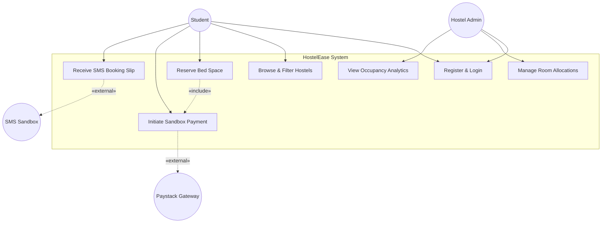
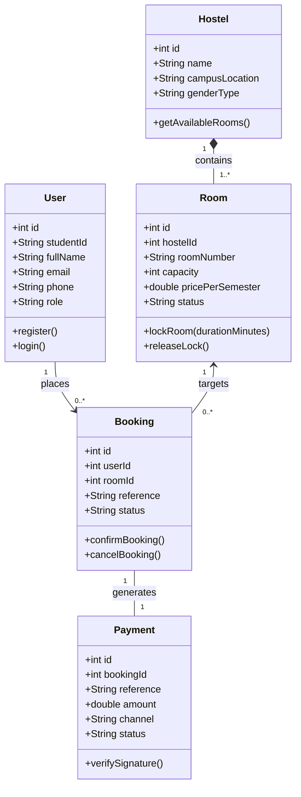
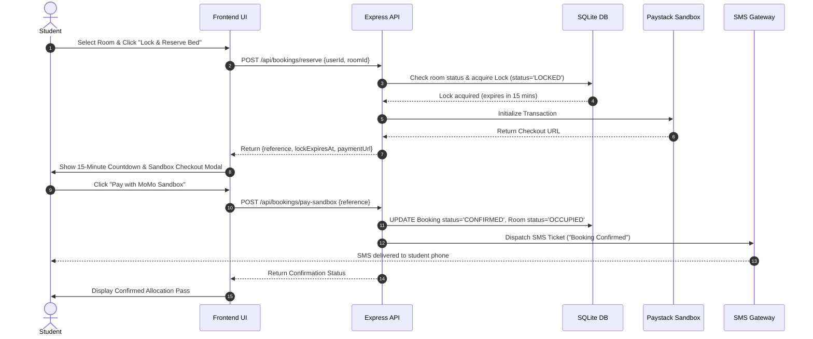

# UML Diagrams & Software Architecture
## Project: HostelEase
**Course:** Software Engineering (Unit 4: UML Diagrams & Unit 5: Design Principles)  
**Repository:** [RichardAmoakoKorang11a/HostelEase](https://github.com/RichardAmoakoKorang11a/HostelEase)

---

## 1. Use Case Diagram

---

## 2. Domain Class Diagram

---

## 3. Sequence Diagram (Booking & Sandbox Payment Flow)

---

## 4. Software Design Principles Applied (Unit 5)
1. **Model-View-Controller (MVC):** Business logic (`services/`), database persistence (`models/`), and presentation (`public/`) are strictly decoupled.
2. **Strategy Pattern for Payment Gateways:** Defined an abstract payment contract allowing effortless switching between Paystack, MTN MoMo Sandbox, or internal mock gateways.
3. **Singleton Pattern for Database Pool:** Centralized connection manager preventing port and handle starvation during high concurrency.
4. **Single Responsibility Principle (SRP):** `SMSService` only handles message delivery and formatting; it knows nothing of room locks or payment verification.

