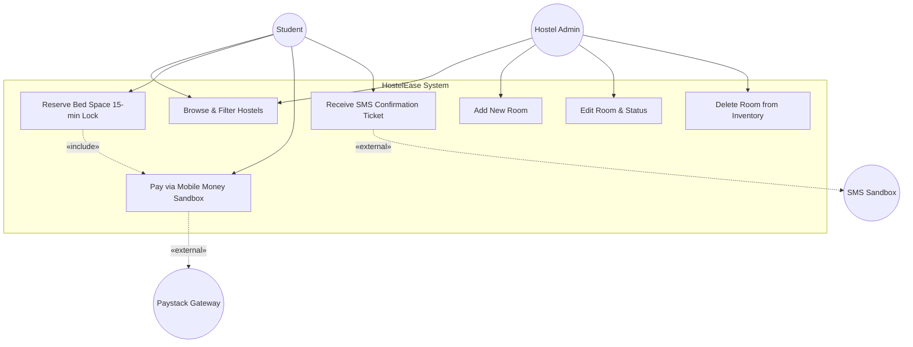
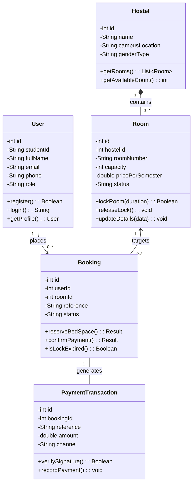
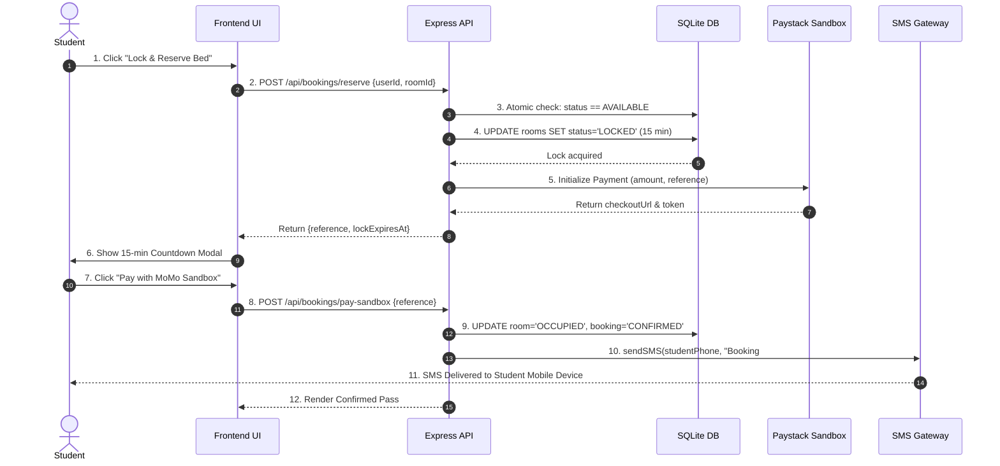

# UML Diagrams, Architecture & Visual Drawings
## Project: HostelEase – Campus Hostel Booking & Allocation System
**Course:** Software Engineering (Unit 4: UML Diagrams & Unit 5: Design Principles)  
**Repository:** [RichardAmoakoKorang11a/HostelEase](https://github.com/RichardAmoakoKorang11a/HostelEase)  

### Team Roster (Group 2):
1. **Osei Sarfo Raphael** (`5240101411`)
2. **Adjei Douglas** (`5240101412`)
3. **Richard Amoako Korang** (`5240101413`) – Project Lead
4. **Ibrahim Mohammed** (`5240101414`)
5. **Sandra Otu** (`5240101415`)

> 💡 **Interactive Visual Viewer:** All high-resolution SVG drawings can be viewed live in the browser by starting the server and visiting:  
> 👉 **`http://localhost:3000/diagrams.html`**

---

## 1. Use Case Diagram (Unit 4)
**File:** [`docs/diagrams/use_case_diagram.svg`](diagrams/use_case_diagram.svg)  
Illustrates the system boundary, the primary Student actor, the Hostel Administrator actor, and external services (Paystack Mobile Money and Twilio SMS).

---

## 2. Domain Class Diagram (Unit 4 & 5)
**File:** [`docs/diagrams/class_diagram.svg`](diagrams/class_diagram.svg)  
Defines the structural domain model, visibility indicators, relationships, and the Strategy pattern interface for payment gateways.

---

## 3. Sequence Diagram (Unit 4)
**File:** [`docs/diagrams/sequence_diagram.svg`](diagrams/sequence_diagram.svg)  
Chronological messaging workflow showing how the 15-minute concurrency lock is established in SQLite and verified via Paystack and SMS.

---

## 4. Activity & State Machine Diagram (Unit 4)
**File:** [`docs/diagrams/activity_diagram.svg`](diagrams/activity_diagram.svg)  
Models the lifecycle and state transitions of room inventory (`AVAILABLE` -> `LOCKED` -> `OCCUPIED`), including the automated 15-minute timeout rollback.

---

## 5. Relational Database Entity-Relationship (ER) Diagram (Unit 6)
**File:** [`docs/diagrams/er_diagram.svg`](diagrams/er_diagram.svg)  
Complete relational diagram with Primary Keys (`PK`), Foreign Keys (`FK`), Unique Keys (`UK`), and Crow's Foot cardinality notations connecting `USERS`, `HOSTELS`, `ROOMS`, `BOOKINGS`, and `PAYMENTS`.

---

## 6. 3-Tier System Architecture Diagram (Unit 5 & 10)
**File:** [`docs/diagrams/architecture_diagram.svg`](diagrams/architecture_diagram.svg)  
Separation of concerns between Presentation Tier (Tailwind CSS UI & PWA pass), Application Server Tier (Express.js REST API & Concurrency Lock Engine), and Persistence & External Integration Tier (SQLite DB + Paystack + Twilio/Hubtel).

---

## 7. Sprint Roadmap & 3-Week Role Rotation Gantt Chart (Unit 9)
**File:** [`docs/diagrams/sprint_roadmap.svg`](diagrams/sprint_roadmap.svg)  
Visual Gantt timeline of the 8-week project showing the 3 sprints and the rotational assignment of Project Manager, Lead Developer, QA Lead, Documentation Lead, and Architecture Lead across Group 2.
