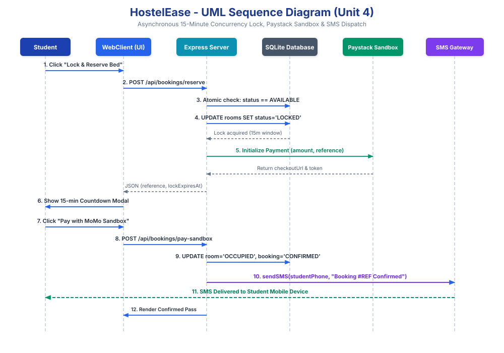
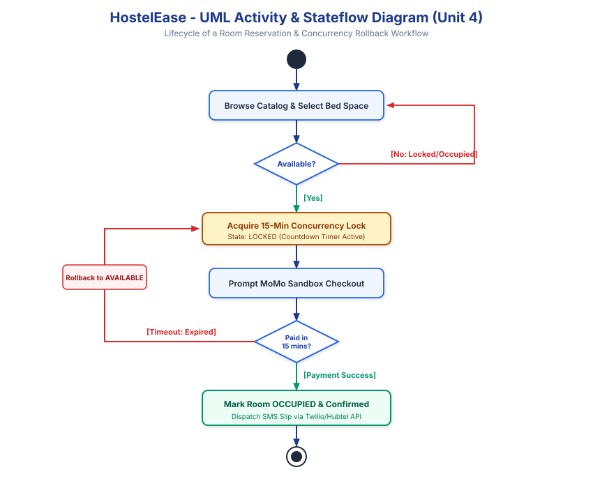
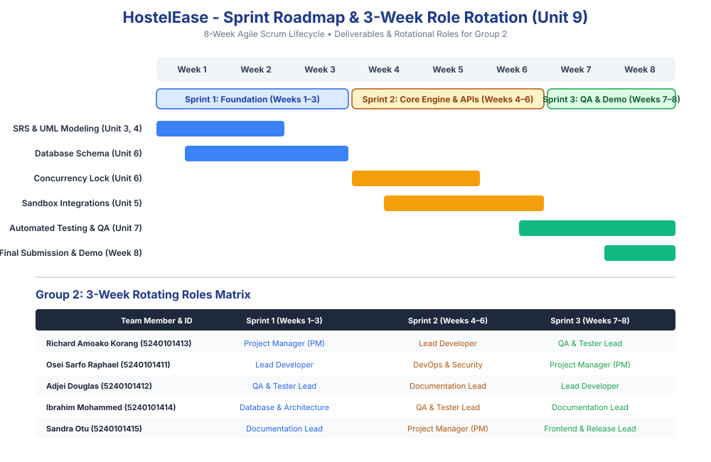

# UML Diagrams, Architecture & Visual Drawings
## Project: HostelEase – Campus Hostel Booking & Allocation System
**Course:** Software Engineering (Unit 4: UML Diagrams & Unit 5: Design Principles)  
**Repository:** [RichardAmoakoKorang11a/HostelEase](https://github.com/RichardAmoakoKorang11a/HostelEase)  

### Team Roster (Group 2):
1. **Osei Sarfo Raphael** (`5240101411`)
2. **Adjei Douglas** (`5240101412`)
3. **Richard Amoako Korang** (`5240101413`) – Project Lead
4. **Ibrahim Mohammed** (`5240101414`)
5. **Sandra Otu** (`5240101415`)

> 💡 **Interactive Studio:** View these drawings with live tab switching and PDF export by launching the app and visiting:  
> 👉 **`http://localhost:3000/diagrams.html`**

---

## 1. Use Case Diagram (Unit 4)
Illustrates the system boundary, the primary **Student** actor, the **Hostel Administrator** actor, and external services (**Paystack Mobile Money** and **Twilio SMS**).

---

## 2. Domain Class Diagram (Unit 4 & 5)
Defines the structural domain model, entity attributes, visibility indicators, relationships, and the **IPaymentGateway Strategy pattern** interface.

---

## 3. Sequence Diagram (Unit 4)
Chronological messaging workflow detailing how the **15-minute concurrency lock** is acquired in SQLite, verified via Paystack, and triggers an automated SMS ticket.

---

## 4. Activity & State Machine Diagram (Unit 4)
Models the lifecycle and state transitions of room inventory (`AVAILABLE` ➔ `LOCKED` ➔ `OCCUPIED`), including the automated **15-minute timeout rollback**.

---

## 5. Relational Database Entity-Relationship (ER) Diagram (Unit 6)
Complete relational schema diagram with Primary Keys (`PK`), Foreign Keys (`FK`), Unique Keys (`UK`), and Crow's Foot cardinality notations connecting `USERS`, `HOSTELS`, `ROOMS`, `BOOKINGS`, and `PAYMENTS`.

---

## 6. 3-Tier System Architecture Diagram (Unit 5 & 10)
Separation of concerns between Presentation Tier (Tailwind CSS UI & PWA pass), Application Server Tier (Express.js REST API & Concurrency Lock Engine), and Persistence & External Integration Tier (SQLite DB + Paystack + Twilio/Hubtel).

---

## 7. Sprint Roadmap & 3-Week Role Rotation Gantt Chart (Unit 9)
Visual Gantt timeline of the 8-week project showing Sprints 1, 2, and 3, key unit deliverables, and the rotational assignment of Project Manager, Lead Developer, QA Lead, Documentation Lead, and Architecture Lead across Group 2.

